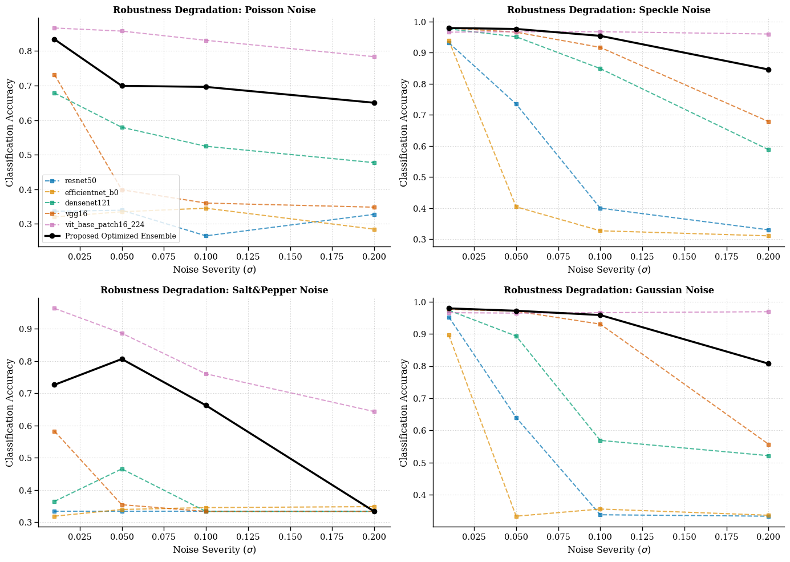
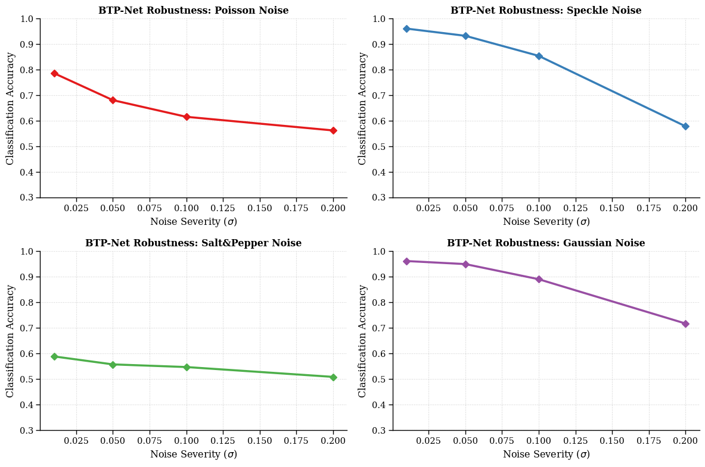
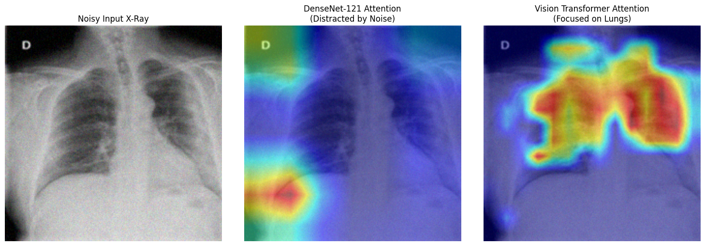

# CNN vs Vision Transformer robustness on chest X-rays

**B.Tech Project (BTP): "Comparative Analysis of ViT and CNN using X-Ray Classification"**
The LNM Institute of Information Technology (LNMIIT), Jaipur

This project trains six image classifiers on a 3-class chest X-ray dataset (COVID-19, Normal, Pneumonia), measures how their accuracy degrades when noise is added to the test images, and deploys the CNNs on a Raspberry Pi 400 behind a small web interface.

> Research and coursework only. This is not a diagnostic tool and must not be used for medical decisions.

## Team

| Role | Name |
|---|---|
| Student | Shulin Agarwal |
| Student | Hatim Ali |
| Student | Yashvardhan Singh Nain |
| Mentor | Dr. Sandeep Saini |

## What we did

1. **Dataset.** Built a balanced set of 4,500 images (1,500 per class) from two public Kaggle datasets, split 70 / 15 / 15 into train, validation and test.
2. **Models.** Fine-tuned five ImageNet-pretrained models (ResNet-50, EfficientNet-B0, DenseNet-121, VGG-16, ViT-Base/16) and trained one small CNN from scratch (BTP-Net, 4 convolution blocks).
3. **Ensemble.** Used Optuna (100 trials) to find the weighting of the five pretrained models that maximises macro AUC on the clean validation set.
4. **Noise stress test.** Evaluated every model on the test set with Poisson, speckle, salt-and-pepper and Gaussian noise at four severity levels (σ = 0.01, 0.05, 0.1, 0.2).
5. **Grad-CAM.** Compared where DenseNet-121 and the ViT look on a noisy image.
6. **Edge deployment.** Served the five CNNs from a Raspberry Pi 400 with FastAPI and measured CPU inference latency.

## Results

### Clean data

Best validation accuracy during 10 epochs of training (675 validation images):

| Model | Best val. accuracy |
|---|---|
| DenseNet-121 | 98.4% |
| VGG-16 | 98.4% |
| ResNet-50 | 98.1% |
| EfficientNet-B0 | 97.8% |
| BTP-Net (custom, from scratch) | 97.8% |
| ViT-Base/16 | 97.6% |

On clean images all six models are within one percentage point of each other.

### Under noise



Test accuracy at the highest noise level (σ = 0.2). Values are read from the plots, so treat them as approximate. Chance level for three classes is 0.33.

| Model | Poisson | Speckle | Salt & pepper | Gaussian |
|---|---|---|---|---|
| ViT-Base/16 | 0.78 | 0.96 | 0.64 | 0.97 |
| Optuna ensemble | 0.65 | 0.85 | 0.33 | 0.81 |
| BTP-Net (custom) | 0.56 | 0.58 | 0.51 | 0.72 |
| DenseNet-121 | 0.48 | 0.59 | 0.33 | 0.52 |
| VGG-16 | 0.35 | 0.68 | 0.33 | 0.56 |
| ResNet-50 | 0.33 | 0.33 | 0.33 | 0.33 |
| EfficientNet-B0 | 0.28 | 0.31 | 0.35 | 0.33 |

What the numbers show:

- **The ViT is the most robust model under all four noise types.** It is almost unaffected by Gaussian and speckle noise, and loses the most under salt-and-pepper noise (0.96 down to 0.64).
- **ResNet-50 and EfficientNet-B0 collapse to chance** under every noise type by σ = 0.1 to 0.2, despite 98% accuracy on clean images.
- **The ensemble does not inherit the ViT's robustness.** Its weights were tuned on clean validation data (DenseNet-121 34%, ViT 32%, VGG-16 21%, EfficientNet-B0 10%, ResNet-50 3%; these vary slightly between Optuna runs). When the CNNs fail under noise they pull the ensemble down, and under heavy salt-and-pepper noise it drops to chance while the ViT alone stays at 0.64.
- **The small custom CNN degrades more gracefully than the larger pretrained CNNs**, staying above 0.5 in every setting.



### Grad-CAM



On this noisy example DenseNet-121's activation sits on the image border and the corner marker, while the ViT's activation covers the lung fields. This is one sample, shown as an illustration rather than a measurement.

## Limitations

- The COVID-19 images come from a different source dataset than the Normal and Pneumonia images, so the models may partly learn which dataset an image came from rather than the pathology.
- Noise is added after ImageNet normalisation, not to the raw pixel values. The Poisson step clamps negative normalised values to zero, which changes dark regions even at low σ; this is why accuracy under Poisson noise is already reduced at σ = 0.01.
- Each model was trained once with one random seed, and noise was sampled once per setting. There are no confidence intervals.
- The noise is synthetic. It approximates, but is not validated against, real scanner artefacts.

## Repository layout

```text
.
├── training/                  GPU training and evaluation pipeline
│   ├── 1_data_preparation.py      download both Kaggle datasets, build the balanced 3-class split
│   ├── 2_train_and_robustness.py  fine-tune five models, Optuna ensemble, noise stress test
│   ├── 3_custom_cnn.py            train BTP-Net from scratch and stress-test it
│   ├── 4_xai_gradcam.py           Grad-CAM comparison, DenseNet-121 vs ViT
│   ├── main.py                    runs the four scripts in order
│   └── requirements.txt
├── notebooks/                 the original working notebooks, with their logged outputs
├── results/                   figures produced by the pipeline
└── raspberry_pi/              FastAPI inference server for the Pi 400
    ├── main.py                    web app and API
    ├── run_inference.py           model definitions, checkpoint loading, benchmark routine
    ├── templates/                 HTML page
    ├── static/                    CSS / JS
    └── requirements.txt
```

The scripts in `training/` are the cleaned-up version of the notebooks. The notebooks are kept as a record of the runs that produced the figures.

## Running the training pipeline

Needs Linux, Python 3.9+, a CUDA GPU, and a Kaggle API token (`~/.kaggle/kaggle.json`) to download the data.

```bash
cd training
pip install -r requirements.txt
python main.py
```

This downloads the data into `btp_raw_data/`, builds `btp_3class_dataset/`, and writes the trained weights (`best_<model>_3class.pth`) and figures (`Fig1_…`, `Fig2_…`, `Fig3_…`) into `training/`. Each script can also be run on its own, in order.

## Running the Raspberry Pi demo

Tested on a Raspberry Pi 400 (quad-core Cortex-A72, CPU only) with Python 3.13.

```bash
cd raspberry_pi
python3 -m venv btp_env
source btp_env/bin/activate
pip install -r requirements.txt
uvicorn main:app --host 0.0.0.0 --port 8000
```

Then open `http://<pi-address>:8000` in a browser, and upload a chest X-ray. For each model the server returns the predicted class, its confidence and the average latency (10 timed runs after 3 warm-up runs).

| Endpoint | Purpose |
|---|---|
| `GET /` | Web page |
| `GET /api/models` | Which models loaded successfully |
| `POST /api/predict` | Upload an image, get every model's result |
| `GET /health` | Liveness check |

The ViT is not deployed on the Pi; the server runs BTP-Net, DenseNet-121, ResNet-50, EfficientNet-B0 and VGG-16.

### Model weights

The trained weights are too large for this repository.

**Download:** _link to be added_

The server expects each checkpoint as an unzipped folder next to `main.py`:

```text
raspberry_pi/
├── best_custom_btp_net_3class/data.pkl
├── best_densenet121_3class/data.pkl
├── best_resnet50_3class/data.pkl
├── best_efficientnet_b0_3class/data.pkl
└── best_vgg16_3class/data.pkl
```

A model whose checkpoint is missing is reported as unavailable; the others still run.

## Data sources

The images are not redistributed here. `1_data_preparation.py` downloads them from:

- [Chest X-Ray Images (Pneumonia)](https://www.kaggle.com/datasets/paultimothymooney/chest-xray-pneumonia) for the Normal and Pneumonia classes
- [COVID-19 Radiography Database](https://www.kaggle.com/datasets/tawsifurrahman/covid19-radiography-database) for the COVID-19 class

Please follow each dataset's licence and citation requirements.
